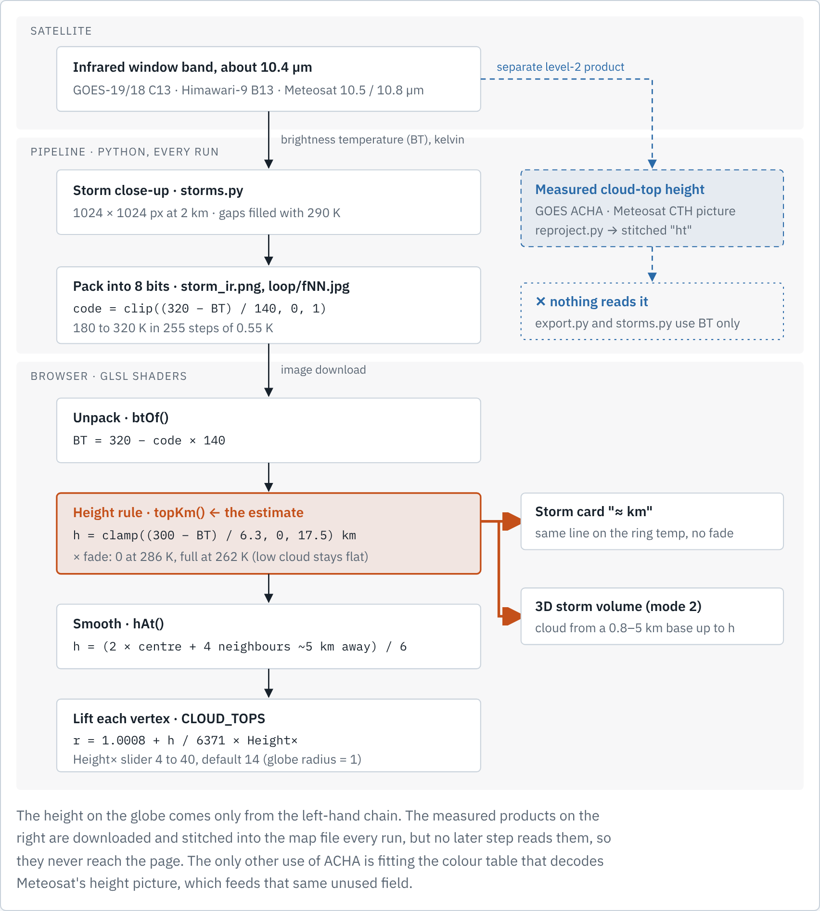
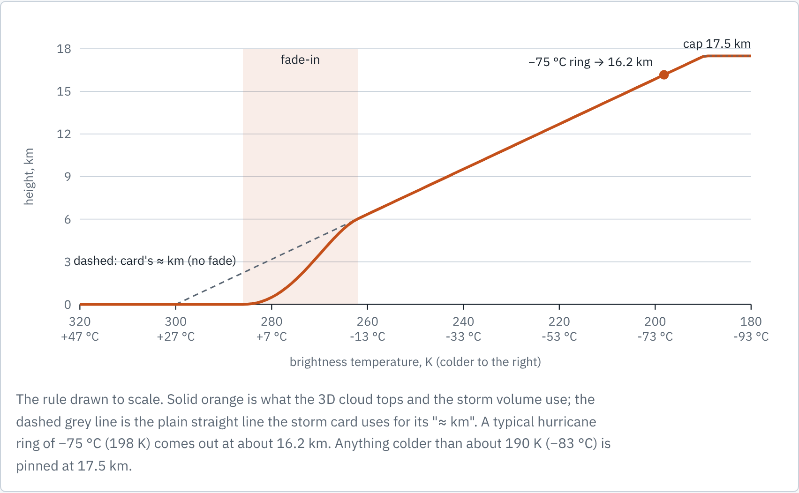
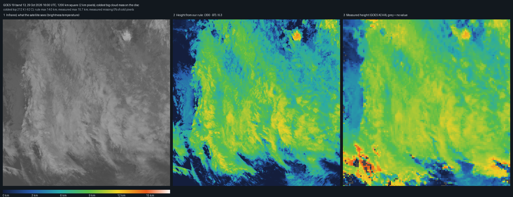

# How Hurrix gets a cloud's height

Every height on the globe is worked out from one number per pixel: how cold the cloud top looks to the satellite's infrared window channel. No measured height is used anywhere on screen. The colder the top, the higher the page assumes it is, on a straight line of 6.3 K per kilometre that starts at 300 K at sea level.

```
height (km) = clamp((300 - BT) / 6.3, 0, 17.5) x fade(BT)
```



## The chain, step by step

1. **The satellite.** The infrared window band, about 10.4 µm (GOES C13, Himawari-9 B13, Meteosat 10.5 / 10.8 µm). Each pixel is a temperature reading of whatever it looks at, here the cloud top. It works at night too. The temperature is called brightness temperature (BT), in kelvin.
2. **Close-up.** `pipeline/storms.py` cuts a 1024 x 1024 close-up at 2 km per pixel around each storm. Pixels the satellite cannot see are set to 290 K.
3. **Pack.** `code = clip((320 - BT) / 140, 0, 1)`, written to 8-bit images (`storm_ir.png`, `loop/fNN.jpg`). One step is about 0.55 K, which is about 90 m of height, so packing costs almost nothing.
4. **Unpack.** In the browser, `btOf()` in `src/hdr/glsl.ts`: `BT = 320 - code x 140`.
5. **Height rule.** `topKm()`: `clamp((300 - BT) / 6.3, 0, 17.5)` times a fade that is 0 at 286 K and full at 262 K, so low warm cloud stays flat instead of making bumps.
6. **Smooth.** `hAt()` averages the centre pixel (twice) and four neighbours about 5 km away, divided by 6, so single pixels do not spike.
7. **Lift.** In the `CLOUD_TOPS` vertex shader each vertex sits at radius `1.0008 + h / 6371 x Height-x`, with the Height slider at 14 by default (4 to 40), globe radius 1.

The same rule is used by the storm card's "about km" line (`src/meta.ts` `topKm`, without the fade) and by the 3D storm volume (`density()` in `glsl.ts`, which fills cloud from a 0.8 to 5 km base up to `h`).



A typical hurricane ring of -75 °C (198 K) comes out at about 16.2 km. Anything colder than about 190 K (-83 °C) is pinned at 17.5 km.

## Where this is an estimate, not a measurement

- **One fixed atmosphere everywhere.** 300 K at sea level and 6.3 K of cooling per km, with no latitude or season. The same temperature can sit at different heights in different places.
- **Thin cirrus reads too low.** The rule treats every pixel as an opaque cloud top. Thin or broken cloud lets warmer radiation through, so its BT is too warm.
- **Low cloud is flattened on purpose** (warmer than 286 K, below about 2.2 km).
- **The top is capped** at 17.5 km, a stand-in for the tropical tropopause. Above it temperature no longer falls with height, so the line would not hold anyway.
- **Gaps are filled, not seen** (290 K, which becomes zero height).
- **The relief is exaggerated for the eye.** At 14x, a 16 km top is drawn about 224 km up. The shape is right, the vertical scale is not.

## Measured heights are fetched but not used

The pipeline also downloads measured cloud-top height: GOES ACHA (`ABI-L2-ACHAF`, variable `HT`, metres) and Meteosat's height picture (`decode_cth` in `pipeline/meteosat.py`, calibrated against ACHA). `pipeline/reproject.py` stitches them into `stitched_4096.npz` as `ht`. Nothing reads `ht` afterwards: `export.py` and `storms.py` use only the temperature, and the storm close-ups carry only the temperature. Himawari-9 has no height input in the pipeline, although it publishes one (`AHI-L2-FLDK-Clouds`, `AHI-CHGT`).

### A sample



Left: the raw infrared (bright is cold). Middle: the height from the rule above. Right: GOES ACHA over the same pixels, with about five times fewer pixels (10 km against 2 km). The big cloud mass is at about 9 to 12 km in both, and the small bright tower at the top shows in both. They disagree in places, for example the bottom-left corner, where the measured panel is much taller. The square is the coldest large cloud mass on the disc, not a named storm.

### Why it is parked

A check on one full-disk GOES-19 frame (29 Oct 2026, 16:00 UTC; ACHA matched to band 13 by scan-angle coordinates, not hurricane-specific):

| BT range | pixels | ACHA missing |
|---|---|---|
| below 215 K | 8,278 | 13.0 % |
| 215 to 235 K | 34,950 | 7.5 % |
| 235 to 262 K | 138,164 | 8.9 % |
| 262 to 280 K | 200,935 | 7.1 % |
| above 280 K | 539,505 | 29.2 % |

Where both exist and BT is below 235 K (39,525 px), the median ACHA height is 11.9 km and the median from the rule is 11.8 km, a median difference of -0.3 km. So on average the rule and ACHA agree for cold tops in this frame. It is one frame and one satellite, so it says nothing yet about storm cores over time. The gaps of 7 to 13 % in cold cloud and the coarser grid are why the measured heights are not wired in. Before any wiring, check ACHA gaps and agreement inside storm close-ups over many frames and storms. See [issue #13](https://github.com/aunai-org/Hurrix/issues/13).

## Data endpoints

All anonymous and reachable from the pipeline today.

- **GOES-19 / GOES-18 (S3):** `https://noaa-goes19.s3.amazonaws.com/` (and `noaa-goes18`), listed with `?list-type=2&prefix=...`.
  - `ABI-L2-CMIPF/{yyyy}/{doy}/{hh}/`: band 13 and the visible bands.
  - `ABI-L2-ACHAF/{yyyy}/{doy}/{hh}/`: cloud-top height in metres.
  - `ABI-L2-MCMIPF/...`: the multi-band file for the day side.
- **Himawari-9 (S3):** `https://noaa-himawari9.s3.amazonaws.com/`
  - `AHI-L2-FLDK-ISatSS/{yyyy}/{mm}/{dd}/{hhmm}/`: the tiled bands we use.
  - `AHI-L2-FLDK-Clouds/{yyyy}/{mm}/{dd}/{hhmm}/`: `CHGT` height, `CMSK` cloud mask, `CPHS` phase (not used yet).
  - Also `AHI-L1b-FLDK/`, `AHI-L1b-Japan/`, `AHI-L1b-Target/`, `AHI-L2-FLDK-Winds/`.
- **Meteosat-12 / Meteosat-9:** EUMETView map service, `https://view.eumetsat.int/geoserver/ows`. Infrared `mtg_fd:ir105_hrfi` and `msg_iodc:ir108`; height `msg_fes:cth` and `msg_iodc:cth` (colour pictures every 15 minutes, decoded through `pipeline/meteosat_cal.json`); colour `mtg_fd:rgb_truecolour` and `msg_iodc:rgb_natural`.
- **Storm lists and tracks:** `https://www.nhc.noaa.gov/CurrentStorms.json`, `https://ftp.nhc.noaa.gov/atcf/btk/b{id}.dat`, `https://www.metoc.navy.mil/jtwc/rss/jtwc.rss`.

## Files

`src/hdr/glsl.ts` (`btOf`, `topKm`, `hAt`, `CLOUD_TOPS`, `density`), `src/meta.ts`, `src/ui.ts`, `pipeline/storms.py`, `pipeline/export.py`, `pipeline/reproject.py`, `pipeline/meteosat.py`.
